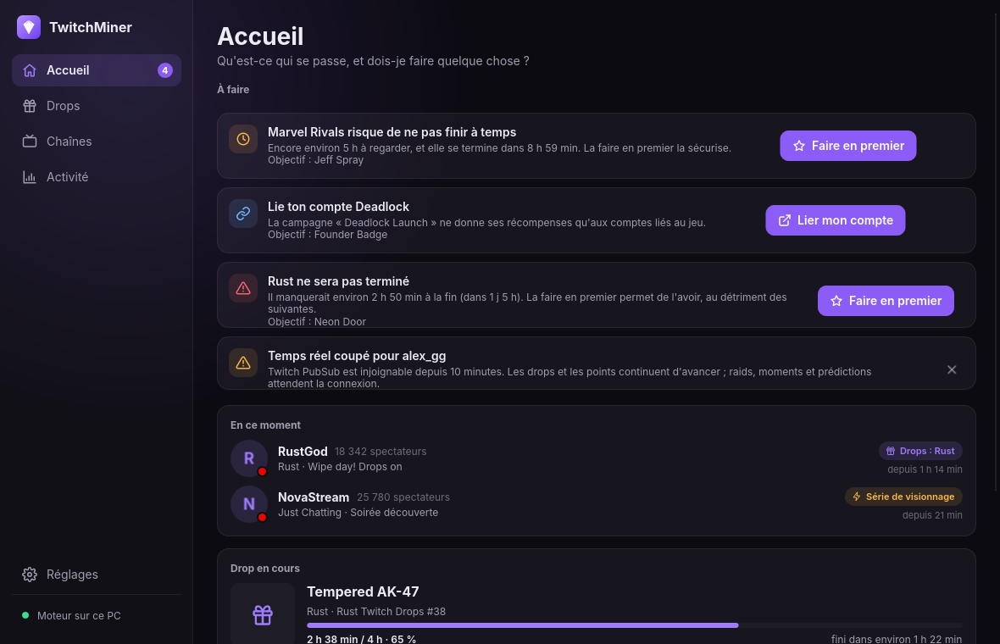
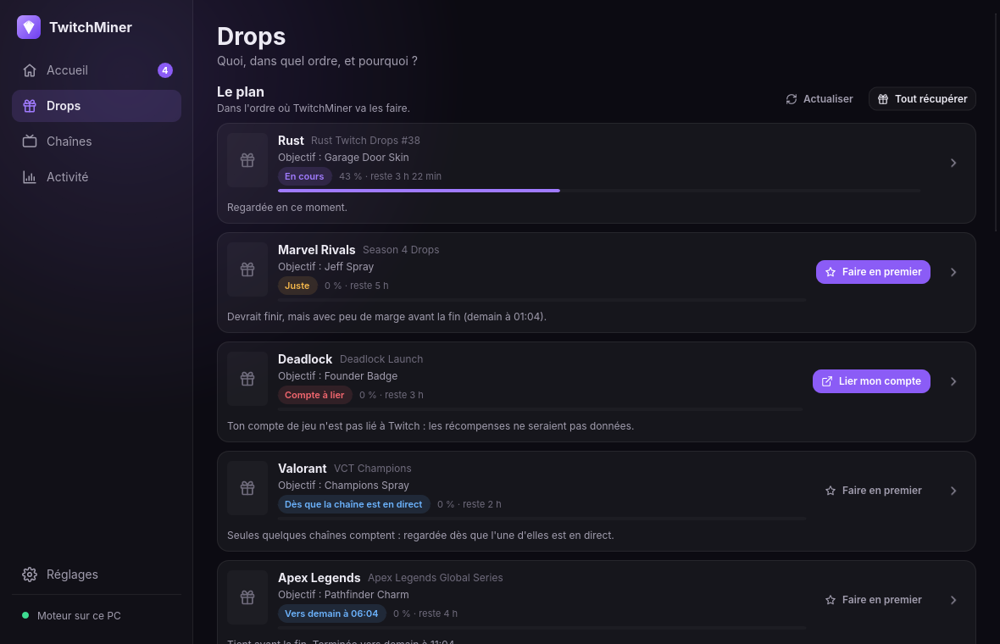
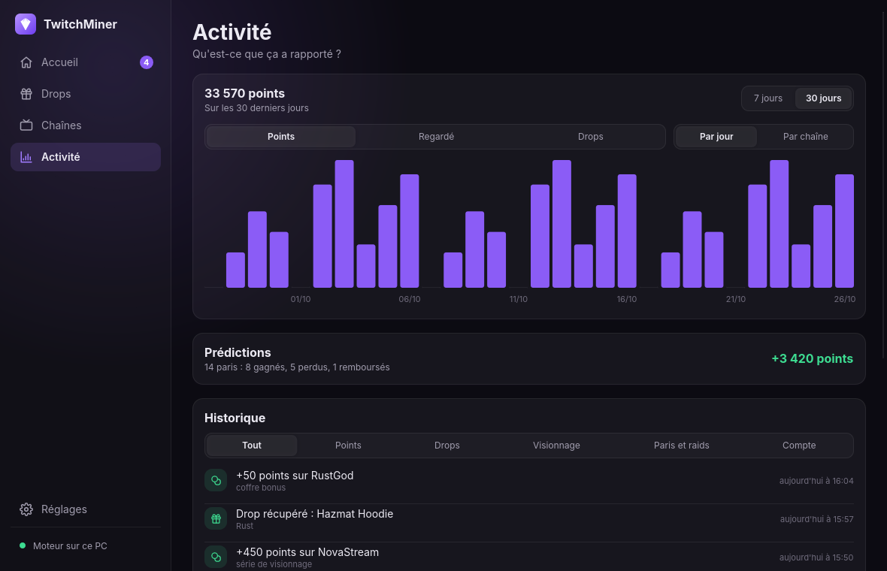
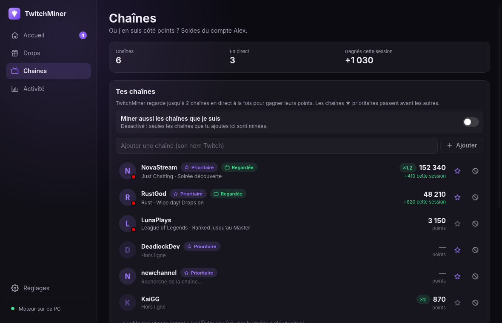
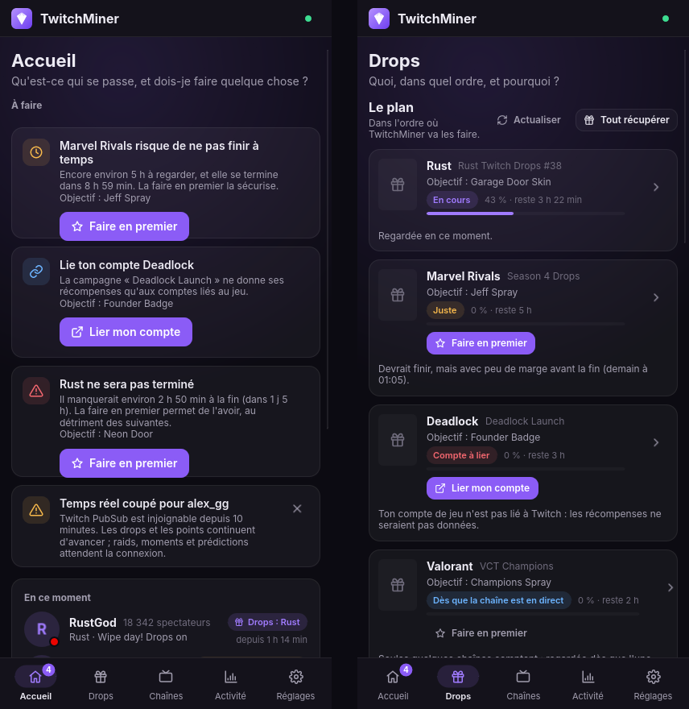

<div align="center">


# TwitchMiner

**Tes drops et tes points de chaîne Twitch, récupérés tout seuls.**

Une appli légère pour Windows, Linux et Android, et un serveur pour la faire tourner 24 h/24.

[Télécharger](https://github.com/Thinsh0/TwitchMiner/releases/latest) · [Démarrer](#démarrer) · [Documentation](#documentation)



</div>

## Ce que ça fait

TwitchMiner regarde des streams à ta place, en arrière-plan et en qualité minimale, pour remplir tes campagnes de drops et accumuler des points de chaîne. Il choisit quoi regarder, dans quel ordre, et te prévient quand tu dois faire quelque chose.

- 🎁 **Drops** : il trouve les campagnes, les planifie selon **ton ordre de jeux**, fait passer devant celles qui vont bientôt finir, et récupère les récompenses. « Faire en premier » sur une campagne, alertes quand c'est juste ou qu'un compte de jeu doit être lié.
- 💜 **Points de chaîne** : tes chaînes préférées, coffres bonus, raids, moments, séries de visionnage. Prédictions automatiques en option, avec garde-fous.
- 🔔 **Notifications** sur ton téléphone (ntfy), Discord ou Telegram, et sur le bureau.
- 🖥️ **Appli de bureau** discrète : elle vit dans la barre système et se met à jour seule.
- 📱 **Appli Android** pour suivre et piloter ton serveur de n'importe où.
- 🏠 **Mode serveur** : une image Docker pour un NAS, un Raspberry Pi ou un mini PC, qui mine même PC éteint.
- 👥 **Plusieurs comptes**, et même ceux de tes amis : chacun ne voit et ne règle que les siens.
- 🛡️ **Résistant aux changements de Twitch** : ses identifiants internes se mettent à jour sans nouvelle version.

## Aperçu

<table>
<tr>
<td width="50%"><br><sub><b>Drops</b> : le plan, dans l'ordre où il sera fait, et pourquoi.</sub></td>
<td width="50%"><br><sub><b>Activité</b> : points, temps regardé et drops, par jour ou par chaîne.</sub></td>
</tr>
<tr>
<td width="50%"><br><sub><b>Chaînes</b> : soldes de points, priorités, chaînes en direct.</sub></td>
<td width="50%" align="center"><br><sub><b>Android</b> : la même appli, sur ton téléphone.</sub></td>
</tr>
</table>

## Démarrer

Tout se télécharge sur la page des [**Releases**](https://github.com/Thinsh0/TwitchMiner/releases/latest).

**Sur ton PC (Windows)**
1. Télécharge `TwitchMiner-…-windows.exe`, mets-le dans un dossier où il restera, et lance-le : il s'ajoute au menu Démarrer.
2. Choisis « Utiliser ce PC », puis **Connecter un compte Twitch** et valide le code sur la page de Twitch.
3. Dans **Drops**, ajoute tes jeux dans l'ordre qui t'importe. C'est tout : fermer la fenêtre le laisse tourner dans la barre système.

**Sur un serveur (Docker), pour miner PC éteint**

```bash
docker run -d --name twitchminer --restart unless-stopped \
  -v twitchminer:/data -p 7878:7878 ghcr.io/thinsh0/twitchminer
```

Puis connecte l'appli de bureau ou Android au serveur (« Serveur distant »). Guide complet, avec Dockge, Portainer, systemd et Tailscale : [docs/SERVER.md](docs/SERVER.md).

**Sur ton téléphone** : installe `TwitchMiner-…-android.apk` et connecte-le à ton serveur ([docs/ANDROID.md](docs/ANDROID.md)).

**Linux** : archive `…-x86_64-unknown-linux-gnu.tar.gz` (appli + daemon), ou daemon statique `…-linux-musl` pour x86_64 et ARM ([docs/CLI.md](docs/CLI.md)).

> [!NOTE]
> Automatiser le visionnage n'est pas prévu par les conditions d'utilisation de Twitch. TwitchMiner reste discret (une seule connexion légère par chaîne, pas de vidéo téléchargée), mais tu l'utilises à tes risques.

## Documentation

| | |
|---|---|
| [Appli de bureau](docs/DESKTOP.md) | moteur local ou distant, Windows, mises à jour, notifications |
| [Serveur maison](docs/SERVER.md) | Docker, Dockge, systemd, Tailscale, miner pour un ami, secours entre machines |
| [Android](docs/ANDROID.md) | installer l'APK, se connecter, notifications avec ntfy |
| [Ligne de commande](docs/CLI.md) | le daemon `twitchminer` et `twitchminer ctl` |
| [Agents IA](docs/AGENT.md) | piloter TwitchMiner depuis un agent (MCP) |
| [Développement](docs/DEVELOPMENT.md) | compiler, organisation du code, CI et versions |
| [Architecture](docs/ARCHITECTURE.md) · [API](docs/API.md) · [Modules](docs/MODULES.md) | pour aller plus loin |

## État du projet

| | |
|---|---|
| Moteur : drops, points, prédictions, notifications, multi-comptes, invités | ✅ |
| Appli de bureau Windows / Linux | ✅ |
| Serveur Docker amd64 / arm64 | ✅ |
| Appli Android (client d'un serveur) | 🆕 |
| Moteur embarqué dans l'appli Android | 🔜 |

Fait en Rust, interface en [Slint](https://slint.dev).
